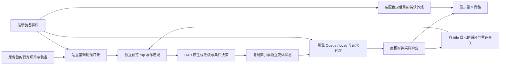

# 面板 idle 选择与快速换装：oar-idle2

> Historical experiment report. Current ownership: [SceneGraph previews](scene-graph.md); sequence rules: [animation previews](animation.md). The old process-global scheduler, catalogue-only sibling scan and indefinite Start-only dwell are superseded. Logical candidate paths come from native replacement metadata, separately from deduplicated binding names.

日期：2026-10-16。源码基线：`526dddb`，本轮工作区修改在其之上。
当前轮次：`oar-idle2`，在前一轮 `oar-preview1` 的工作区修改上继续实现。范围限定为站立
idle 选择、连续过渡及快速换装打断；游戏行为仍待本轮验证。

## 当前链路

玩家实际第三人称 3D 提供外观；原玩家提供身份、装备与允许的环境条件；面板自己的状态、
clip 载体和时钟提供动作。主路径不创建 Actor，不推进原角色行为图。



旧实现的全局八帧窗口、`selected_clip` 裸指针及 `pick_running_clip()` 显示回退已从主路径
移除。无需等待世界产生一次 clip 激活；旧交接的“只剩索引问题”结论不再适用。

## 二进制证据与 ABI 修正

用户下载的 3.1.6 DLL/PDB 与此前安装版记录一致：

- DLL SHA-256：`d94e55f257d404e4f30bc6d60983e94c1379f92d916598b2b069930c5ad31434`
- PDB SHA-256：`bce55bee19d57839ba2e2fd5219266018ee8fb7057e95887701f39c59ed596e1`

地址由匹配 PDB 的 `.text` 十进制段内偏移加 `0x1000` 得到，并用 DLL 反汇编核对入口与
实参读取。3.2.1 也用此前下载的匹配 DLL/PDB 独立计算，未套用 3.1.6 地址。

| 符号／用途 | 3.1.6 RVA | 3.2.1 RVA |
| --- | --- | --- |
| `OpenAnimationReplacer::GetSingleton` | `0xF7CD0` | `0x3F290` |
| `ForEachReplacerProjectData` | `0x199780` | `0xDAEE0` |
| `ReplacerProjectData::GetAnimationReplacements(uint16)` | `0x1EBEA0` | `0x12DD50` |
| `AnimationReplacements::EvaluateConditionsAndGetReplacementAnimation(refr, clip)` | `0x1EB2A0` | `0x12D150` |
| `ReplacementAnimation::GetIndex(Variant*&)`（普通索引／布局锚点） | `0x1E28F0` | `0x1247A0` |
| `ConditionSet::EvaluateAll(refr, clip, submod, forceTrace)` | `0x10BBB0` | `0x52C10` |
| `ReplacementAnimation::EvaluateConditions(refr, clip)` | `0x1E2160` | `0x124010` |
| `GetReplacementAnimation(character, clip, originalIndex)`（字段锚点） | `0x1A5660` | `0xE6E00` |
| `ReplacementAnimation::GetParentSubMod` | `0x1E2A50` | `0x124900` |
| `SubMod::GetParentMod` | `0x1EC070` | `0x12DF20` |
| `ReplacementAnimation::GetReplaceOnLoop` | `0x1E2A80` | `0x124930` |

**旧地址 `0x1A5720` 实际是 `OpenAnimationReplacer::GetReplacements(character, index)`。**
它把 `RDX` 当 character、`R8W` 当索引；旧声明却传入 replacements、refr 和 clip。
`with-replacements=0` 时最后一跳未执行，不能从此前遍历成功推导整条链 ABI 正确。

运行时检查插件版本、PE 时间戳／大小、CodeView GUID／age、原有 hook 入口与查询的十一个
入口字节；所有查询入口必须存在且匹配。idle2 新增的三项是读取配置的函数，没有新增 detour。
条件集合／候选守卫与原有两条 hook 同事务安装。不分发 OAR DLL/PDB，运行时无需 PDB。

其他已核实布局：

- `character +0x50 → setup +0x40 → characterData +0x98` 为 stringData；两版 OAR 字符查询
  包装函数实际这样读取，不沿 `hkbProjectData` 猜字段。
- ConditionSet 起始为 MSVC `shared_mutex`，entries begin/end 在 `+0x8/+0x10`；原函数
  调用 `_Smtx_lock_shared` 并读取这些位置。
- replacement 的 variant tag 在 `+0xA0`；Variants 锁在 `+0x28`，active／sequence／random
  在 `+0x30/+0x48/+0x60`，模式／累计权重在 `+0x78/+0x80`。
- `ShouldSaveToJson` 在两版 DLL 中都读取 Variants 的 `+0x20/+0x21/+0x22` 与 `+0x98`，
  对应变体混合、循环随机重置、共享历史与 scope。Variant 自身的 PlayOnce 在 `+0x29`，
  由两版 `Variant::ShouldSaveToJson` 反汇编核实（3.1.6 `0x20D5F0`，3.2.1 `0x17D090`）。
- clip 载体大小 `0x110`，node name 在 `+0x38`、node id 在 `+0x40`、animationName 在
  `+0x48`、binding index 在 `+0x70`。预览 node id 为 `0xFFFF`，不注册为活动节点。
- loader context 为 `0x50` 零载体，只填 character／behavior；绑定集元素的 binding 在
  `+0x10`。装卸方式参照 OAR FakeClipGenerator 和既有 HKX18 游戏证据。

## 查询与状态隔离

查询先从原版站立候选名取得基础索引，再只访问 stringData 指针完全一致的 project。
识别 female／male 原版子目录和完整路径，排除 OAR/DAR 追加替换路径，不按同文件名误选
替换件。缓存只存目录元数据，不依赖玩家历史上是否播过某个动作。

候选仍由 OAR 按自身顺序和优先级选择。预览专用 EvaluateAll 守卫在集合读锁内审计后调用
原条件对象，保留 AND 语义。第三方条件、preset／custom component、IdleTime 和
其他未建模条件拒绝该候选；它们不会借读来源真实行为而意外放行。

Random 通过公开组件接口按名称读取 Minimum／Maximum／Numeric／Comparison／State。
比较、禁用和否定保留原规则，随机值存于面板内；支持原版允许的 Local／Submod 范围与
循环重置开关，不调用原角色的 OAR 状态存储。一次循环内重复求值保持同一个随机结果。

投影只匹配当前线程调用栈、本次来源和独立 clip。潜行、跳跃、速度、游泳、攻击和骑乘等
按站立状态回答；MOUNT 包装也回答无骑乘。已建模数字图变量使用预览值，未建模数字变量
拒绝候选。HasGraphVariable 只借用原图声明存在性的判断，不借用变量当前数值。

通常的装备条件读取原玩家；卸装片段可以用之前真实左右手的 form 快照，支持 IsEquipped、
IsEquippedType 和 IsEquippedHasKeyword，正确使用 Numeric＋Bool 组件。编号保留剑 1、
双手剑 5、弓 7、法杖 8、弩 9、战锤 10、盾 11 等原语义。旧实例附魔／绑定效果尚无适配，
会明确拒绝，不猜旧实例状态。粗略 WeaponForm 只用于基础动作族，不替换 OAR 装备类型编号。

replacement／variant 指针不越过原生选择读锁；只复制索引、名字、配置与不解引用的身份值。
`selection_state.h` 管理面板内的权重随机、顺序、PlayOnce 和共享历史，支持变体的
Local／Submod／ReplacerMod 范围。共享随机值由当前主导层在允许的循环点重置。
候选提议不推进序列；资源被接受并开始播放后才记录进度，被换装取消的候选不会被算作已播。
同一个替换在装备条件刷新后仍有效时，保持其当前变体；同一文件续播不统一重启时钟。
状态寿命限定于本次面板会话，不复现 OAR 的世界状态清理、Echo、每帧可中断重评、动作触发器
或 functions。无需把其完整 ActiveClip 生命周期搬进面板；关闭后重新打开为新会话。
不支持的条件会落到其他有效候选或原版站立基础片段，不能宣称任意动作包全部兼容。

## 播放和换装

- PanelAnimation 以 MT_Idle 为身体底层，检查躯干、头、双腿关键骨覆盖；持械时添加对应
  武器族 idle，法术／法杖区分左右手，弓、弩和双手近战分开。出鞘状态与装备形态独立。
- 装载只对独立 clip 调用 Queue／Load，不调用玩家 Activate／Update／通知事件。载体有
  独立租约和绑定强引用；关闭面板或会话重置时释放。卸载用保留的 behavior 构造 fake
  character，避免依赖已清空的来源 character；CRT 退出阶段不调用引擎释放接口。
- 身体、武器与另一只手的 idle 分别按自身周期处理。循环时先检查 OAR 的重评开关及序列
  进度：序列中途优先续播，允许重评才重新查候选；抽中相同动作时继续播放，不重建其他层。
  新动作尚未装载时保持有效旧动作。切换片段单次播放，完成后回最新装备 idle。
- 装备事件和实际手部／出鞘／根身份变化合并，装配签名连续稳定四帧才重新捕获外观。
  双手武器／弓弩先规范化手槽读数，避免槽翻转刷新风暴；捕获失败保留上一个已接受图并重试。
  装备事件立即递增动作请求代次并作废旧提议；动作请求与外观落定门分开。仅重捕获同一
  装备时，未完成切换保留进度，活动、待装载及逐层提议都重绑到新图。
- 已出鞘时换武器选对应 equip；收起／移除可选旧武器族 unequip。衣甲变化或无对应片段时，
  刷新外观并用 0.15 秒姿态过渡；收刀状态保持普通站立 idle。
- 新图过渡从先前已显示姿态开始，不从新捕获的跳跃／潜行姿态开始。身体基础片段未就绪
  时不绘制未摆好姿态的模型。
- 快速 A→B→C 换装时，不排队播完 B；C 就绪后从当时可见姿态过渡到 C 的切换动作。
  加载结果接受前检查代次及当前装备；较早切换结束不能把状态改回旧装备 idle。

当前仅接受普通 binding；additive／镜像、同步动画、根运动和触发器需专门适配。替换装载
失败或覆盖不足会尝试原版基础片段，不回放来源当前动作。HKX 文件自身内容仍由作者定义。
旧图安全回收仍未解决；自动换装会产生停放副本，不能把 bookkeeping 上限当作内存上限。

## 验证与上机

默认／实验两个 Release 构建与 snapshot_transform 的 31 项本地检查全部通过。
idle2 新增七项：Random 缓存、权重与共享状态、PlayOnce 提交、循环重评规则、最新请求、
各层周期和过渡中断。固定种子的一万次抽样检查 1:3 权重，并验证同轮缓存及零权重边界。
这些检查不启动 Skyrim，不等于实际 detour、引擎资源装卸和所有动作已在游戏通过。

本轮 idle2 包已核对压缩包、Release 输出和 manifest 的 DLL／PDB 校验一致；两版 OAR 的
十一个查询入口均再次直接与对应 DLL 文件比较通过。

| 项目 | 值 |
| --- | --- |
| 文件 | `dist/CharacterPanel-scopy-oar-idle2-1.2.1.zip` |
| 构建身份 | `CharacterPanel-scopy-oar-idle2-526dddb08d+dirty-cl94faaed0c6-20261016T083341Z` |
| 打包时间 UTC | `2026-10-16T08:43:14Z` |
| 目标环境 | Skyrim AE 1.6.1170 / SKSE 2.2.6，scene-copy ON |
| DLL SHA-256 | `7ffb92a15dfe9c5a49d593ce9dec4835a8d1155ae0506461f26b4581a035f6d6` |
| PDB SHA-256 | `24186c035502b40d136ad9997820723d34c319afab97551abf98c513d0d60a5e` |
| ZIP SHA-256 | `3dc4ffc20eb84f79b5abe1fb41c4d84361a76cd3e9facdaf796e30369d4ceb10` |

上一轮 `oar-preview1` 的交付身份保留如下；本轮 idle2 另包交付，不覆盖此包：

| 项目 | 值 |
| --- | --- |
| 文件 | `dist/CharacterPanel-scopy-oar-preview1-1.2.1.zip` |
| 构建身份 | `CharacterPanel-scopy-oar-preview1-526dddb08d+dirty-cl94faaed0c6-20261016T041108Z` |
| 打包时间 UTC | `2026-10-16T05:02:15Z` |
| 目标环境 | Skyrim AE 1.6.1170 / SKSE 2.2.6，scene-copy ON |
| DLL SHA-256 | `dbdbbba634f9d21f75ffd93944d2f9206db797ab31955fbbb8e072f6572ff6c1` |
| PDB SHA-256 | `799b6f01b922f8187e9c61b98d5ac199dddbad339285c40f3ce88f65264164dd` |
| ZIP SHA-256 | `9e0bd3b3e68f19be3c6bfe6405473520006d3d51dea32a6953cfbb0d298765d9` |

源码为基线之上的未提交修改；后续提交不会追写该包身份。

```powershell
cmake --preset Release -B build-scopy -DCHARACTER_PANEL_SCENE_COPY_EXPERIMENT=ON -DCHARACTER_PANEL_PROBE_REVISION=oar-idle2
cmake --build build-scopy --config Release --target CharacterPanel CharacterPanelCopyMathTest
ctest --test-dir build-scopy -C Release -R '^snapshot_transform$' --output-on-failure -V
cmake --build build-scopy --config Release --target CharacterPanelSceneCopyPackage
```

优先验证：已有带 Random、权重或顺序／PlayOnce 的 idle 包；循环重评关闭时保持当前替换；
不同时长的身体／武器 idle 不互相重启；B 切换未完就换 C／D，最终只回最新装备 idle；
过渡进行中再次换装不跳回起点；装载稍慢、同武器重捕获、开关面板和读档。
站立／潜行／腾空／游泳／骑乘开包及左右法术／法杖仍需覆盖；关包后原角色应正常继续。
同时确认 UBE 外观与此前已通过的渲染一致，本轮没有改透明绘制代码。

返回 CharacterPanel.log、manifest 与画面。证据行为 active query available、SCOPY PANEL
query（project/base/index/replaced/evaluated/overridden/rejected）、asset ready、phase 和
transition complete -> idle。零替换须结合 diagnostic，不能把尚未执行的调用当作 ABI 通过。

来源：[OAR 3.1.6](https://github.com/ersh1/OpenAnimationReplacer/tree/0c1c8b38a5323b9e26df41ff9d10ce801b984a45/src)、
[OAR 3.2.1](https://github.com/ersh1/OpenAnimationReplacer/tree/f4e7688b065175aff70aa523073857911e15aca3/src)、
[HKX18 引擎装载证据](s2-hkx18-engine-load-2026-10-10.md)。
