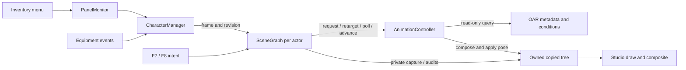

# SceneGraph previews

## Purpose

SceneGraph is the sole character-preview backend. It copies a source actor's existing scene graph and owns that preview's observation, animation, framing and drawing. No second Actor is created or controlled.

## Scope and non-goals

The preview shows standing weapon posture and existing equipment/appearance. Animation targets equipped non-combat idles independently of world action, after observed native Smooth goal preparation. Empty hands use the configured loop/direct-base choice. This change adds no movement/attack mirroring, multi-actor UI, physics registration, FaceGen controller, shader/material work or safe graph destruction. The source graph/transforms stay read-only; native `NiObject::Clone` copies its graph. [dac::Session](dac.md) temporarily borrows only controlled original-Actor marker effects and restores them at the UI close boundary.

更新：2026-11-02。独立图调查保留 [G1/G2 的有界通过](independent-behavior-graph.md#verification-matrix)、v41 G3-A 源相位与 [G3-B/F 相位回放通过](independent-behavior-graph.md#c-g3b-f-full-replay)。G2 109/116 实际写骨及三未知缺失名、同 controller 来源/generation 替换与 frozen-only 的未验限制不变。G4 的 A/B/C PASSED 属历史裁定，其中 [A numeric 全窗覆盖](independent-behavior-graph.md#g4-followup-numeric)已由 v63 运行关闭（整窗 72/72 `type=0`、逐窗对账相等），只剩 [C 兼容源事件窗口](independent-behavior-graph.md#g4-followup-source-events)一项 PENDING；B 只支持当前装备族稳定。G5 可准备逐骨/层/误差协议，运行验收后置；G6 待验。

最新记录安装 [v64](build.md#v64-g4c1-concurrent-events-2026-11-02)（DLL `ff00daad…` / PDB `3364ea18…`），部署 INI 为 C1 运行配置 `f714e05f…`（A4 键集 + `SourceEventCapture=concurrent`）；本次未重新核验安装。候选与控制器源图共享 data/绑定、变量活值分储；共享绑定或候选哈希相同不证明源候选完整姿态、时钟、层/权重相同。G6 仍涵盖源恢复、请求/任务失效、引用/回调/sink/历史及重复会话收敛；每进程一张候选为显式例外，装载 teardown NO-GO，无有效全局登记计数锚，DAC restore matched 仅部分证据。

[r4](diagnostics/display-issues-2026-10-22.md#r4-session) provides partial runtime evidence for product shield/torch behavior, while copy retirement remains unresolved.

The local [v44 candidate display clock](independent-behavior-graph.md#v44-display-clock) schedules 60 native steps per elapsed second between eligible draws, with a 100 ms/six-step catch-up cap. Timing-only waits keep the current valid pose in stepped mode. Request/view changes, rejection and ineligible/frozen fallback reset the origin; compatible OAR clocks are unchanged. Native-step counters are independent of draw counts. [Two timing regressions and Release build](build.md#v44-display-clock-2026-10-29) passed at that checkpoint; the later v46 normal-path run did not validate native DisplayStep speed/visual pacing.

The local [v46 retirement correction](#retired-copy-accounting-v46) preserves every ordinary retired copy handle and reports process-total retention. Its [20261030 normal-path observation](#v46-manual-regression) confirms handle accounting, while native memory reclamation and lifecycle convergence remain unproven.

## Architecture

`CharacterManager` registers source actors, collects per-actor equipment-event revisions and distributes `PreviewFrame` menu/lifetime inputs in the serialized render bracket. Each registered `SceneGraph` retains its source handle, monitor/controller, copied tree and placement state. Its `update` method decides when to observe, request animation, capture, retarget, poll resources and toggle drawing. Input only queues F7/F8 intent on that object.

`SceneGraph` implements graph copying, source/copy audits and retirement privately in `scene_graph_capture.cpp`. `SceneGraph::replace_graph` rebuilds placement/node data and retargets the same controller while the previous tree is still retained, then parks it. Compatible copied-graph replacement preserves normal animation clocks. The experimental `DisplaySession` instead starts a new view measurement window and refreshes coverage when retarget rebuilds the node map; this does not rewind the retained candidate. The renderer calls manager update and the selected SceneGraph's draw method inside D3D state-capture scopes. It cannot switch to an Actor or puppet backend.

Animation remains a separate module: OAR returns copied query metadata; animation owns annotation clocks, leases, accepted variant history and pose composition. SceneGraph separately owns a native DAC session, whose inventory entry snapshot survives appearance/equipment/source-graph retarget. See [animation previews](animation.md).




## Code map

| Path | Entry points |
| --- | --- |
| [scene_graph.h](../src/character/scene_graph.h), [scene_graph.cpp](../src/character/scene_graph.cpp) | `SceneGraph`, `PreviewFrame`, `request`, `update`, `replace_graph`, `draw` |
| [character_manager.h](../src/character/character_manager.h), [character_manager.cpp](../src/character/character_manager.cpp) | `register_actors`, `get_scene_graph`, `EquipSink::ProcessEvent`, `update`, `clear_previews` |
| [scene_graph_capture.cpp](../src/character/scene_graph_capture.cpp) | private `SceneGraph::capture_graph`, `retire_graph`; source/copy audits |
| [equipment_state.h](../src/character/equipment_state.h), [equipment_state.cpp](../src/character/equipment_state.cpp) | read-only `equipment_weapon_form`, `equipment_hand_ids` |
| [figure_audit.h](../src/character/figure_audit.h), [figure_audit.cpp](../src/character/figure_audit.cpp) | collision-helper classification and appearance-settle signature |
| [snapshot_transform.h](../src/character/snapshot_transform.h) | `snapshot_delta`, `recompute_subtree_worlds` |
| [input.cpp](../src/input/input.cpp), [main.cpp](../src/main.cpp), [renderer.cpp](../src/render/renderer.cpp) | queued controls, lifetime/installation, update/draw bracket |
| [independent_graph.h](../src/animation/behavior_graph/independent_graph.h), [display_state_policy.h](../src/animation/behavior_graph/display_state_policy.h) | `DisplaySession`, `DisplaySourceIdentity`, `DisplayWindow`, `apply_named_display_pose`; experimental view validity and actual copied-node assignments |
| [behavior_graph_display_session_test.cpp](../tests/behavior_graph_display_session_test.cpp), [behavior_graph_display_step_test.cpp](../tests/behavior_graph_display_step_test.cpp) | focused engine-free session/window/motion/coverage and shared-step/read regressions |
| [CMakeLists.txt](../CMakeLists.txt), [CMakePresets.json](../CMakePresets.json), [plugin.h.in](../cmake/plugin.h.in) | single backend and generated build identity |

The opt-in candidate display is owned by animation's [DisplaySession](../src/animation/behavior_graph/independent_graph.h). It accepts only the retained actor/source-graph/generation/controller-owner identity. New requests and close/reset discard partial measurements; changed source identity or a destroyed owner rejects both frozen and stepped reads and continues through OAR. A same-source reopen may reuse the retained candidate with a fresh window. The experiment creates at most one candidate per process; a changed source may require a game restart. Native retention is separate from view validity and never authorizes teardown.

## Interfaces and controls

- F7 queues recapture of the player's current graph while a paused inventory is open. When accepted capture changes the copied root, retarget refreshes experimental coverage/baselines and begins a new view window even if source/request are unchanged.
- F8 queues display toggle for that same SceneGraph.
- Menu state/revision comes only from `PanelMonitor`; equipment events only increment watched actor revisions.
- `clear_previews` queues release for the next serialized update. Expired source handles unregister; temporarily missing 3D suspends a session while retaining the source record.

There are no Actor spawning, dressing, inventory synchronization or body-morph copying controls. Removed diagnostic hotkeys have no active handlers; F7/F8 do not enable the opt-in graph experiment, which is configured through INI settings and requires a restart.

`SceneGraph::observe_source` also records left torch presence independently of the body family for the [one-handed body/arm composition](animation.md#equipment-context-and-torch-composition-2026-10-23). Retarget rebinds the owned arm layer alongside body/standing/calibration for pending, active and outgoing proposals. Source equipment/transform/framing policy does not change.

Outside paused inventory, `SceneGraph::update_monitor` also asks `AnimationController::prepare_base_indices` to prepare the [finite base-action cache](animation.md#fixed-base-indices-and-project-readiness) through the existing third-person graph resolver. This observes metadata only: no clip/graph advancement, condition/Random/history evaluation, DAC/IED call or source mutation. Preparation waits for published graph/behavior/skeleton and covering binding data, then scans the engine names once while copying only matched finite originals. LoadingMenu updates return before observing old source graphs. Existing `CharacterManager::release_previews` clears project metadata at world boundaries; table identity/count changes also rebuild. A late-ready project may initialize on the menu path with an explicit diagnostic. Capture/Clone and first-use resource costs remain separate and unchanged.

## Invariants

Native capture, lease release, pose writes and graph replacement stay in the render/update bracket. Input callbacks never clone or animate. Animation requests, Random/variant history and source/display generations stay per source actor. A graph replacement retargets before its old nodes are retired. Source graph audits reject aliased writable state; copying never advances or writes the source actor's graph.

Rendering retains geometry filtering, standing-pose calibration, material submission and D3D binding restoration. Copied graphs remain detached from engine menu roots. Retired copied trees deliberately remain parked: a function-static pointer owns one heap vector of `NiPointer` values, and that vector intentionally survives static teardown. No retained handle is erased or cleared. `SCOPY PARK scope=process retained-total=...` counts all retained handle entries across actors and preview lifetimes; 12 is only a diagnostic threshold, with a single warning when the total reaches 13. Native allocations remain unbounded and safe teardown is unresolved; complete tracking does not reclaim memory.

Placement calibration normally uses the vanilla MT_Idle standard: `AnimationController::apply_standing_pose` samples the independent base calibration asset at time zero, and `SceneGraph::draw` calls `calibrate_from_posed_bound` before writing the current action on the same frame. Calibration waits while that asset is pending. If its lease fails, the standing underlay is also the vanilla base; action poses never supply calibration. [Event timing and dynamic selection](animation.md#event-timing-and-native-state) describes the separate animation policy.

## Held equipment invariant

After source/copy correspondence and isolation pass, [hold_copy_equipment](../src/character/held_equipment.cpp) maps actual equipped biped `item`/`partClone` identities to owned copy objects. A weapon's `TESObjectWEAP::GetNodeName` provides the exact root identity when needed; shield lookup uses `GetShieldObject`. Missing or ambiguous roots log actor/form/side rather than selecting an arbitrary model. Inventory-only weapons and unrelated quivers stay untouched.

Mapped equipment retains a `NiPointer` across detach/attach and preserves its model-local rotation, translation and scale. Right-hand weapons/staves mount at copied WEAPON, left-hand items and shields at SHIELD; bows/crossbows explicitly use SHIELD. Two-handed weapons are handled once. During an equip transition the mapped model is parked on its captured sheath parent until the clip's `weaponDraw` annotation, then reattached to the hand; unequip reverses while the copy still holds the model. The copied model/mount becomes visible; copied Scb/ScbLeft geometry is hidden without unhiding unrelated child effects/LOD/blood objects. Generic HKX Weapon/Shield/Quiver tracks map independently to WEAPON/SHIELD/QUIVER; sheath WeaponSword/MOV chains are never held targets.

No source node, equipment/draw flag or Actor graph is mutated. The helper receives capture-local ownership correspondence; native graph retirement and source/isolation audits remain intact. This source-backed parenting design is not an in-game visibility result: identical-form dual roots, custom skeletons, bow/crossbow/scabbard visibility and paused presentation still require game verification.

## Opt-in capture, placement and mount evidence

`DetailedAnimationTrace=true` adds observations around existing decisions, with actor/latest requested request/accepted request/capture ID and graph pointers. `SCOPY CAPTURE-DUE` records the already-computed pending/settled/manual flags, current revision and request reason; it does not remeasure assembly. `SCOPY CAPTURE` records actual acceptance/rejection and old/new graph, and `SCOPY GRAPH` identifies the accepted graph's calibration request. These are capture events, not per-poll waiting messages. A newer requested generation can coexist with an older visible accepted clip.

At most once per request, `SCOPY SOURCE-SNAPSHOT/SOURCE-NODE` records the shared fixed fifteen body/arm names from [Trace_Body_Nodes](../src/animation/diagnostic_trace.h). Matching occurs during the **already-required** source local/world/bound copy pass, and the log uses those saved local/world transforms before Clone. It adds no full source traversal. The header says `paused-source phase=before-clone`; this is not a settled world-animation reference or an atomic all-bone measurement. Node/parent names and pointers are actual values; absent requested nodes say missing, unnamed objects say `<unnamed>`, and absent parents say `<none>`. Local/world translation units are game units, rotation is x/y/z/w quaternion, scale is a ratio.

`SCOPY PLACEMENT` records raw placement once per accepted capture before standing calibration. `SCOPY CALIBRATION` reuses the existing measured anchor/offset/radius and applied roots, or identifies the unmeasurable/raw-kept outcome. There is no additional bound measurement, root solve or camera change. `SCOPY MOUNT-MAP` reports successful existing helper choices: form/side, mapped source/copy model, prior/target parent and retained local transform. Immutable `HeldDiagnosticIds` carry request/accepted-request/capture correlation. `SCOPY MOUNT-SWITCH` records only an actual parent change made by the existing draw/sheathe policy, preserving the same local transform and operation order.

Join graph pointers/capture IDs to `POSE PROBE/SAMPLE` and [ANIMATION HANDOFF](animation.md#correlating-reported-issues), whose source is an observed weaponDraw/weaponSheathe annotation or the unchanged duration midpoint. The common [request-budgeted probe](animation.md#bounded-axe-pose-and-projection-evidence-2026-10-22) uses post-composition copy transforms/projection; the source snapshot and copy can represent different phases and coordinate contexts. No layer weight/mask or source-track bone semantic is inferred. Missing names, budget exhaustion or a missed transient must remain inconclusive.

Default-off tracing skips source-name matching and all new formatting/projection/successful mount detail. Capture isolation/source audits and their handling remain unconditional, as do actual mounting, calibration, animation dispatch and normal accepted mappings. Native parent operations, render timing and all reported visual causes remain **UNVERIFIED**; see the [current symptom procedure](diagnostics/display-issues-2026-10-22.md#10-2026-10-23-装备上下文与火把分层修复待上机).

## Failure modes

Unavailable source 3D suspends the session. Failed capture/audit retains the last accepted graph and retries through the existing settle/request flow. Unsupported or failed animation resources follow the animation module's diagnostics and stable-idle handling. Commands outside a usable paused inventory are ignored with an event log. Default logs retain accepted mappings, event-driven paused-source snapshots and required audits; issue traces, capture geometry lists and common pose probes require `[Diagnostics] DetailedAnimationTrace=true` and a restart. Pose evidence is limited to four windows/twenty-four snapshots per request, each window expiring after 4.1 seconds with the existing twelve slots. Ordinary info flushes periodically about once per second; warnings/errors flush immediately.

## Dependencies

Existing C++23, VS2022/MSVC 14.44.35207, Windows SDK, CommonLibSSE, SKSE, OAR and the installed vcpkg dependencies remain required. The existing gated OAR metadata getters remain. Native phase processing uses the supported original DAC binary and UI-session transaction described in [DAC compatibility](dac.md#original-binary-compatibility-and-provenance). No DAC rebuild or tomlplusplus dependency remains. Source actor handles and hand/form reads remain necessary inputs. No source Actor is created; only the documented DAC marker transaction may temporarily mutate its effects.

## Verification

[Build](build.md) records the single Release target and the archived [v46 DLL/PDB](build.md#v46-retained-copy-ledger-2026-10-29). Reuse the recorded two-case checks for [v42 display sessions](build.md#v42-residual-corrections-2026-10-29), [v43 source windows](build.md#v43-source-sessions-2026-10-29) and [v44 display clock](build.md#v44-display-clock-2026-10-29); this documentation pass reruns no tests/build. The [v46 first-game-pass procedure](#v46-manual-regression) below has two **OBSERVED 2026-10-30** workflow categories on the 20261030 rebuild; the 20261029 pair was not the tested binary. Later experimental source/frozen/application checks remain under the [independent-graph checklist](independent-behavior-graph.md#v32-manual-checklist) and [v42 observation requirements](independent-behavior-graph.md#v42-residual-corrections).

Build/source checks establish compilation and structural consistency, not game-time hook, loader, framing, visual or lifetime behavior. [Maintenance](code-maintenance.md#debugging-navigation) maps actual logs and the two representative runtime follow-up categories. Later AE 1.6.1170/MO2 sessions provide the bounded evidence in [r4](diagnostics/display-issues-2026-10-22.md#r4-session) and [G1/G2](independent-behavior-graph.md#current-status); they do not close complete visual or lifecycle acceptance.

<a id="retired-copy-accounting-v46"></a>
## V46 complete retired-copy accounting (2026-10-29, local only)

> Current qualification (2026-11-02): the local-only/deployment statements in this dated implementation record describe 2026-10-29. The [20261030 rebuild run](#v46-manual-regression) later observed both normal workflows; it does not prove native memory reclamation or convergence. Latest recorded installation is v62, as described above.

[SceneGraph::retire_graph](../src/character/scene_graph_capture.cpp) now moves every non-null retired root into one heap-allocated `std::vector<RE::NiPointer<RE::NiAVObject>>`, reached through a function-static pointer. The heap owner deliberately has no shutdown destructor, so retained native references survive every SceneGraph instance and static teardown. Vector relocation uses the pinned CommonLib `NiPointer` noexcept move constructor, which steals `_ptr` and nulls the source; moved-from destruction cannot detach the native object. This supports container movement, not destruction of a retained native graph. Per-copy heap wrapper allocations and erased raw-pointer entries are removed.

The two existing callers are unchanged: replacement retargets the controller to the new graph before retiring `previous`; destruction calls `close_session` before retiring `m_graph_object`. Menu close alone still retains the current copy. There is no new native call, traversal, destructor, release attempt, capture limit or source mutation.

Each successful retirement logs `SCOPY PARK actor=... scope=process retained-total=N retention=intentional-process-lifetime`. `actor` identifies the triggering preview; N is the cumulative process-wide number of retained handle entries, not a per-actor count, unique live-graph census or byte measurement. Nothing is removed, so totals continue through 13, 14 and beyond. Exactly at N=13, one warning reports `diagnostic-threshold=12 retained-total=13 retention=intentional-process-lifetime memory-bound=none`. The threshold has no allocation or bookkeeping cap.

Historical `snapshots held alive ...` and `cap reached` lines remain raw evidence of the old implementation. Its pre-erasure collection size plateaued at 13 while older allocations remained retained and their pointers were dropped from bookkeeping. Those printed counts do not establish a native-memory bound or the complete old process total. V46 does not retroactively recover lost historical handles or rewrite logs/counts.

**Memory growth remains unresolved.** Ordinary copied trees can accumulate for every accepted replacement and preview lifetime. This is separate from the investigation's deliberately retained one-per-process independent behavior-graph candidate. That candidate exception does not make ordinary repeated-copy growth a G6 pass. Neither retained handle counts nor `DAC restore matched` establish memory reclamation, native byte usage or repeated-session convergence.

Before a future reclamation design can be approved, evidence must identify the supported native destruction/refcount path and ownership of cloned/shared subobjects, establish render/controller/callback quiescence and safe release order, then validate repeated capture/retarget/close/world-reset cycles on the target runtime. Measure native references/allocations and source stability, including use-after-free/source-corruption checks; a shrinking container or an unchanged root count alone is insufficient. This is a future proof checklist, not release authority in v46.

Verification is bounded SDK move/lifetime inspection, unchanged caller-order inspection, one Release configure/build and protected-file/artifact/navigation checks ([commands, identity and hashes](build.md#v46-retained-copy-ledger-2026-10-29)). No synthetic std::vector test or runtime teardown test was introduced. **Local only: no deployment or game launch.** Native bytes, safe teardown and runtime memory convergence remain unverified; the latest recorded install is v41 and historical r4/G2/G3-A records remain unchanged.

<a id="v46-manual-regression"></a>
## V46 first game pass: source windows and normal preview

This procedure was **executed on 2026-10-30 23:14–23:32** with the local v46 rebuild (`behavior-graph-v46-retained-copy-ledger-20261030`, identity `…-c0f2d81953-cl94faaed0c6-20261030T150024Z`, DLL `70b3560a…`). The 20261029 archive named below was not present on that machine, so the 20261030 rebuild was deployed instead; the run therefore belongs to the new identity and is **not** byte-identical evidence for the 20261029 pair. Both workflow categories were observed; results are in the table at the end of this section.

### Prepare the matched files and settings

Close the game. Back up the installed CharacterPanel.dll, matching PDB and existing INI together. Use the archived pair in `build/behavior-graph-v46-retained-copy-ledger-20261029/`, with the exact sizes and SHA-256 values in the [v46 build record](build.md#v46-retained-copy-ledger-2026-10-29). Its DLL SHA-256 is `1b86665563be9e4534855ec8d629cf84a673326f5ad8c54ce74cfffeb95d4a57`; the matching PDB is `f1b106052ec87d8ff0ef7e4f8e4f8e4fbde1fb0e0fb828b080459311bde1fab3`.

The loaded `SCENEGRAPH BUILD` line must match:

```text
CharacterPanel-scenegraph-behavior-graph-v46-retained-copy-ledger-20261029-38fb82c54f+dirty-cl94faaed0c6-20261029T093244Z
```

Edit only these existing keys in the deployed INI, preserving all other sections, keys and values. This is a temporary test configuration; repository defaults remain unchanged.

```ini
[Diagnostics]
DetailedAnimationTrace=true
BehaviorGraphProbe=false

[Experiment]
IndependentGraph=off
DisplayPose=false
DisplayStep=false
SourceTimeline=true
```

Fully restart the game after the file/settings change. Settings load once at DataLoaded. Confirm the build line and loaded settings before interpreting results; a mismatch is an incomplete preparation, not v46 runtime evidence. A later source commit does not rebuild or relabel this archived pair.

### Workflow 1: independent source windows and load cancellation

1. Stand normally with the preview panel closed. Use the same single-handed weapon and existing equipment hotkey/controls for both windows. Press **F7** outside the panel; retain `arm-requested` and `window-open`.
2. Equip that weapon, wait about two seconds, then unequip it. Let the 20-second window finish and retain `window-closed lines=N`. Press F7 again and repeat the same sequence in another complete window.
3. Compare the two explicit windows: each starts a new baseline/settle state and fresh 800-line allowance; neither inherits exhaustion or comparisons from the previous window. Do not require a fixed word count, identical trajectories or 800 emitted lines. There is no need to exhaust the budget.
4. Open another window with F7, then load an existing test save while it is active. Retain the world-reset/invalidation and load timing. After loading completes and normal source 3D is ready, explicitly press F7 again and let that new window close before starting panel checks. A pending world invalidation takes priority over an arm; if that press did not produce a new `window-open`, preserve the records and explicitly re-arm after invalidation/source readiness. Proceed only after the new window opens and closes.
5. Check that the old window was cancelled, the post-load window starts independently, and traces do not concatenate across source replacement. If a source is lost/replaced, preserve `window-aborted reason=source-lost-or-replaced` rather than interpreting it as a rebase or successful recording. Record a missing open/close or unexpected continuation as unresolved evidence.

### Workflow 2: normal OAR preview, equipment and recapture

1. Open the paused inventory. Equip a one-handed axe, observe equip/start into idle, hold for about six seconds, then unequip. Record any flash toward the camera, repeated start segment, framing jump or stalled transition with the action time and video timestamp when available.
2. Use a right-hand weapon plus left-hand torch, then remove **only the torch**. Keep the right-hand weapon unchanged and observe the left-arm pose, attachment visibility and idle convergence.
3. In the panel, request **three accepted F7 recaptures**, waiting for acceptance between presses. Distinguish requests/rejections from accepted `SCOPY CAPTURE`/`SCOPY GRAPH` records. Then use **F8** to hide/show, close the inventory and reopen it. Record playback continuity, source-effect restoration and any visual anomaly. Do not turn this into a rapid allocation stress run.
4. Correlate accepted replacements with `SCOPY PARK actor=... scope=process retained-total=N`. The count includes all retired handle entries across actors and preview lifetimes, so it need not equal three. Each new PARK event increments the complete process total; an initial capture without an old root need not park anything, and close alone need not retire the current copy. Preserve extra automatic captures and rejection reasons when accounting for the sequence.

Twelve is only a diagnostic threshold; reaching 13 is not required. If the one-time threshold warning appears, retain it as a diagnostic, not a memory bound or reclamation result. Ordinary native copies remain allocated. This normal-path session does **not** validate native DisplayStep pacing, missing candidate-bone names, same-controller candidate rejection, frozen-only fallback or G3-B replay; those remain separate pending experiments.

### Return evidence and restore

| Workflow category | Runtime status | Evidence to retain |
| --- | --- | --- |
| Source windows / load cancellation | **OBSERVED 2026-10-30**（v46-20261030） | 4 次 F7 → 4 个 `window-open`（words=463 稳定）；关闭 58/74/116 行；读档 `window` 被 `invalidated reason=world-reset` 取消，读档后显式 F7 拿到新基线（nodes 36→66）；无 `budget-exhausted` |
| Normal preview / equipment / recapture | **OBSERVED 2026-10-30**（v46-20261030） | 15 次捕获全 `accepted`、0 拒绝、14 条 `SCOPY PARK`（首次无前身），`retained-total` 1→14 严格 +1；13 时唯一一条 `diagnostic-threshold=12` 告警、14 时不再出现；F8 隐显正常；关包重开正常恢复；斧头装备无闪近/重复/取景跳变；只摘火把视觉平滑（日志走 `form=none → queue_idle`，设计上不做过渡） |

补充的三条运行事实：**一次"手不碰键鼠"的干净窗口在 20.03 秒关闭**（23:32:10.075→23:32:30.105，46 行），说明截止时间本身正确；另三次关闭比 20 秒晚 +51.5 s / +2.1 s / +17.8 s，原因是游戏失焦或暂停时 post-UI 采样停止、截止检查只在帧内求值，不是计时错误。只摘火把时 `transition base unavailable form=none; idle only` 属**设计行为**（`controller.cpp` 明确跳过 torch→空 的过渡），视觉平滑与日志不矛盾。产品路径另有一处与本轮无关的遗留缺陷——待机起始段每圈重放，见[动画文档](animation.md#idle-start-replay)。

Return the **complete CharacterPanel.log**, including its build line, loaded settings and surrounding records, plus the exact pair hashes and test-setting values. Keep timing notes and any video with the log. Bounded pose/source snapshots can miss transients or represent different phases; absent rows do not establish absence of a visual problem. Source identity snapshots do not prove setter timing, writer roles or atomic native arrays.

After preserving the log, exit the game, restore the pre-test INI and fully restart. If reverting the binary, restore the backed-up DLL/PDB together. The two workflow categories above are observed on v46-20261030; native reclamation, full visual acceptance and lifecycle convergence remain open. Later G3-B/F passed phase-sequence acceptance; G4 retains two pending evidence qualifications and G5/G6 await acceptance, as tracked in the [current handoff](independent-behavior-graph.md#handoff-20261102-evidence).

## Safe modification

Keep registry/event distribution in CharacterManager and per-preview decisions in SceneGraph. Keep OAR query-only and avoid restoring Actor control as a fallback. Retain copy-isolation, source lifetime, latest-request and lease safeguards. Do not free retired native graphs until a separately approved teardown design exists. Rendering/material behavior is maintained outside this consolidation.

## Synchronized files

Synchronize the SceneGraph implementation (including private capture), manager and direct input/main/renderer consumers, [animation guidance](animation.md), [maintenance map](code-maintenance.md), [README](../README.md), [Changelog](../CHANGELOG.md), [build guidance](build.md), [CMake presets](../CMakePresets.json), generated identity, [shader embedding](../cmake/embed_shaders.cmake), [version resource](../cmake/version.rc.in) and [build/runtime notes](../tools/scene_copy/README.txt).

The generated identity always starts with `CharacterPanel-scenegraph-` and includes the configured label, source/CommonLib revisions, dirty state and configure timestamp. The DLL target/output name remains CharacterPanel / CharacterPanel.dll. No package or install target is generated.

## Related history

The animation ownership checkpoint is commit `a00745a`. Historical summaries cover [OAR queries](history-animation.md#oar), [graph-copy validation](history-rendering.md#scene-copy), [AFP](history-animation.md#final-output) and [M0](history-rendering.md#m0). The superseded reports/logs are recoverable through [the source index](history-sources.md); their former code paths and hotkeys describe recorded revisions, not current controls.
