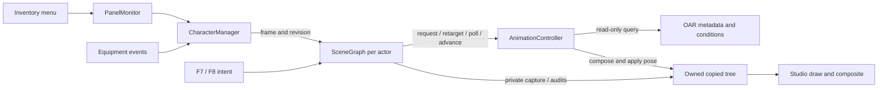

# SceneGraph previews

## Purpose

SceneGraph is the sole character-preview backend. It copies a source actor's existing scene graph and owns that preview's observation, animation, framing and drawing. No second Actor is created or controlled.

## Scope and non-goals

The preview shows standing weapon posture and existing equipment/appearance. Animation targets equipped non-combat idles independently of world action, after observed native Smooth goal preparation. Empty hands use the configured loop/direct-base choice. This change adds no movement/attack mirroring, multi-actor UI, physics registration, FaceGen controller, shader/material work or safe graph destruction. The source graph/transforms stay read-only; native `NiObject::Clone` copies its graph. [dac::Session](dac.md) temporarily borrows only controlled original-Actor marker effects and restores them at the UI close boundary.

## Architecture

`CharacterManager` registers source actors, collects per-actor equipment-event revisions and distributes `PreviewFrame` menu/lifetime inputs in the serialized render bracket. Each registered `SceneGraph` retains its source handle, monitor/controller, copied tree and placement state. Its `update` method decides when to observe, request animation, capture, retarget, poll resources and toggle drawing. Input only queues F7/F8 intent on that object.

`SceneGraph` implements graph copying, source/copy audits and retirement privately in `scene_graph_capture.cpp`. `SceneGraph::replace_graph` rebuilds placement/node data and retargets the same controller while the previous tree is still retained, then parks it. Graph replacement preserves animation clocks. The renderer calls manager update and the selected SceneGraph's draw method inside D3D state-capture scopes. It cannot switch to an Actor or puppet backend.

Animation remains a separate module: OAR returns copied query metadata; animation owns annotation clocks, leases, accepted variant history and pose composition. SceneGraph separately owns a native DAC session, whose inventory entry snapshot survives appearance/equipment/source-graph retarget. See [animation previews](animation.md).

## Code map

| Path | Entry points |
| --- | --- |
| [scene_graph.h](../src/character/scene_graph.h), [scene_graph.cpp](../src/character/scene_graph.cpp) | `SceneGraph`, `PreviewFrame`, `request`, `update`, `replace_graph`, `draw` |
| [character_manager.h](../src/character/character_manager.h), [character_manager.cpp](../src/character/character_manager.cpp) | `register_actors`, `get_scene_graph`, `EquipSink::ProcessEvent`, `update`, `clear_previews` |
| [scene_graph_capture.cpp](../src/character/scene_graph_capture.cpp) | private `SceneGraph::capture_graph`, `retire_graph`; source/copy audits |
| [equipment_state.h](../src/character/equipment_state.h), [equipment_state.cpp](../src/character/equipment_state.cpp) | read-only `equipment_weapon_form`, `equipment_hand_ids` |
| [figure_audit.h](../src/character/figure_audit.h), [figure_audit.cpp](../src/character/figure_audit.cpp) | collision-helper classification and appearance-settle signature |
| [snapshot_transform.h](../src/character/snapshot_transform.h) | `snapshot_delta`, `recompute_subtree_worlds` |
| [input.cpp](../src/input/input.cpp), [main.cpp](../src/main.cpp), [renderer.cpp](../src/render/renderer.cpp) | queued controls, lifetime/installation, update/draw bracket |
| [CMakeLists.txt](../CMakeLists.txt), [CMakePresets.json](../CMakePresets.json), [plugin.h.in](../cmake/plugin.h.in) | single backend and generated build identity |

## Interfaces and controls

- F7 queues recapture of the player's current graph while a paused inventory is open.
- F8 queues display toggle for that same SceneGraph.
- Menu state/revision comes only from `PanelMonitor`; equipment events only increment watched actor revisions.
- `clear_previews` queues release for the next serialized update. Expired source handles unregister; temporarily missing 3D suspends a session while retaining the source record.

There are no Actor spawning, dressing, inventory synchronization, body-morph copying or live-graph diagnostic controls. Removed diagnostic hotkeys have no active handlers.

## Invariants

Native capture, lease release, pose writes and graph replacement stay in the render/update bracket. Input callbacks never clone or animate. Animation requests, Random/variant history and source/display generations stay per source actor. A graph replacement retargets before its old nodes are retired. Source graph audits reject aliased writable state; copying never advances or writes the source actor's graph.

Rendering retains geometry filtering, standing-pose calibration, material submission and D3D binding restoration. Copied graphs remain detached from engine menu roots. Retired copied trees deliberately remain parked: function-static bookkeeping holds raw pointers to retained native references, so destroying a SceneGraph cannot release them. The twelve-entry cap limits bookkeeping only; retained native allocations are not bounded by it and may accumulate across captures and preview lifetimes. There is no safe native teardown mechanism here.

Placement calibration normally uses the vanilla MT_Idle standard: `AnimationController::apply_standing_pose` samples the independent base calibration asset at time zero, and `SceneGraph::draw` calls `calibrate_from_posed_bound` before writing the current action on the same frame. Calibration waits while that asset is pending. If its lease fails, the standing underlay is also the vanilla base; action poses never supply calibration. [Event timing and dynamic selection](animation.md#event-timing-and-native-state) describes the separate animation policy.

## Held equipment invariant

After source/copy correspondence and isolation pass, [hold_copy_equipment](../src/character/held_equipment.cpp) maps actual equipped biped `item`/`partClone` identities to owned copy objects. A weapon's `TESObjectWEAP::GetNodeName` provides the exact root identity when needed; shield lookup uses `GetShieldObject`. Missing or ambiguous roots log actor/form/side rather than selecting an arbitrary model. Inventory-only weapons and unrelated quivers stay untouched.

Mapped equipment retains a `NiPointer` across detach/attach and preserves its model-local rotation, translation and scale. Right-hand weapons/staves mount at copied WEAPON, left-hand items and shields at SHIELD; bows/crossbows explicitly use SHIELD. Two-handed weapons are handled once. During an equip transition the mapped model is parked on its captured sheath parent until the clip's `weaponDraw` annotation, then reattached to the hand; unequip reverses while the copy still holds the model. The copied model/mount becomes visible; copied Scb/ScbLeft geometry is hidden without unhiding unrelated child effects/LOD/blood objects. Generic HKX Weapon/Shield/Quiver tracks map independently to WEAPON/SHIELD/QUIVER; sheath WeaponSword/MOV chains are never held targets.

No source node, equipment/draw flag or Actor graph is mutated. The helper receives capture-local ownership correspondence; native graph retirement and source/isolation audits remain intact. This source-backed parenting design is not an in-game visibility result: identical-form dual roots, custom skeletons, bow/crossbow/scabbard visibility and paused presentation still require game verification.

## Failure modes

Unavailable source 3D suspends the session. Failed capture/audit retains the last accepted graph and retries through the existing settle/request flow. Unsupported or failed animation resources follow the animation module's diagnostics and stable-idle handling. Commands outside a usable paused inventory are ignored with an event log. Logs identify actor/request/capture and meaningful transitions; no frame/bone tracing is enabled.

## Dependencies

Existing C++23, VS2022/MSVC 14.44.35207, Windows SDK, CommonLibSSE, SKSE, OAR and the installed vcpkg dependencies remain required. The existing gated OAR metadata getters remain. Native phase processing uses the supported original DAC binary and UI-session transaction described in [DAC compatibility](dac.md#original-binary-compatibility-and-provenance). No DAC rebuild or tomlplusplus dependency remains. Source actor handles and hand/form reads remain necessary inputs. No source Actor is created; only the documented DAC marker transaction may temporarily mutate its effects.

## Verification

[Build](build.md) documents the single Release target, pinned setup, generated outputs and configure-time identity. Prior native evidence and its limits are recorded in [Build verification](build.md#verification-and-limits). The two animation cases compile directly as documented there; no CMake test target is added.

Build/source checks establish compilation and structural consistency, not game-time hook, loader, framing, visual or lifetime behavior. [Maintenance](code-maintenance.md#debugging-navigation) maps actual logs and the two existing representative runtime follow-up categories. No Skyrim runtime is available here.

## Safe modification

Keep registry/event distribution in CharacterManager and per-preview decisions in SceneGraph. Keep OAR query-only and avoid restoring Actor control as a fallback. Retain copy-isolation, source lifetime, latest-request and lease safeguards. Do not free retired native graphs until a separately approved teardown design exists. Rendering/material behavior is maintained outside this consolidation.

## Synchronized files

Synchronize the SceneGraph implementation (including private capture), manager and direct input/main/renderer consumers, [animation guidance](animation.md), [maintenance map](code-maintenance.md), [README](../README.md), [Changelog](../CHANGELOG.md), [build guidance](build.md), [CMake presets](../CMakePresets.json), generated identity, [shader embedding](../cmake/embed_shaders.cmake), [version resource](../cmake/version.rc.in) and [build/runtime notes](../tools/scene_copy/README.txt).

The generated identity always starts with `CharacterPanel-scenegraph-` and includes the configured label, source/CommonLib revisions, dirty state and configure timestamp. The DLL target/output name remains CharacterPanel / CharacterPanel.dll. No package or install target is generated.

## Related history

The animation ownership checkpoint is commit `a00745a`. Dated [OAR query](oar-preview-query-2026-10-16.md), [graph-copy validation](scene-graph-copy-validation.md), [AFP](afp-summary-2026-10-13.md) and [M0](m0-handoff.md) reports are historical evidence. Their deleted source paths and old hotkeys describe their recorded revisions, not current controls.
